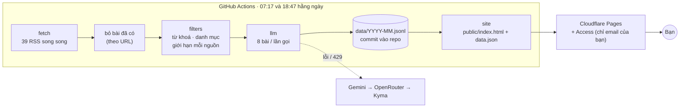

# Tech News

Trang tin công nghệ cá nhân, tự cập nhật mỗi ngày, gần như không tốn chi phí hạ tầng.
Đọc 39 nguồn RSS → lọc nhiễu → AI phân loại và tóm tắt tiếng Việt → lưu vào git → website tĩnh chỉ mình bạn xem được.



## Cấu trúc

```
tech_news/            code (mỗi file một việc)
  config.py           đường dẫn và hằng số (BATCH, SITE_DAYS, danh mục hợp lệ)
  fetch.py            tải và parse RSS/Atom, một feed hỏng không làm dừng cả lượt
  reach.py            chạy lệnh Agent-Reach (config/reach.yaml), đổi JSON về cùng dạng với RSS
  filters.py          từ khoá, danh mục cố định theo nguồn, loại nhiễu, xếp hạng và giới hạn
  llm.py              gọi model (OpenAI-compatible), kiểm tra JSON trả về, fallback giữa provider
  store.py            lưu nối thêm, mỗi tháng một file .jsonl
  pipeline.py         lượt chạy hằng ngày, nối các bước trên
  site.py             sinh public/ từ data/
  cli.py              python -m tech_news {run|build}
config/
  feeds.yaml          danh sách nguồn RSS (tên nguồn quyết định danh mục cố định)
  reach.yaml          nguồn thêm qua Agent-Reach: GitHub search, YouTube, web hackathon
  classify-prompt.md  system prompt phân loại
web/index.html        giao diện (JS thuần: tab danh mục, tìm kiếm, lọc ngày, sắp xếp)
data/                 dữ liệu bài viết, đây là "database" (lịch sử git = backup)
tests/                pytest
docs/architecture.md  logic chi tiết và các quyết định thiết kế
.github/workflows/    daily.yml (chạy hằng ngày + deploy), ci.yml (lint + test)
```

## Chạy ở máy local

```bash
python -m venv .venv && . .venv/bin/activate
pip install -r requirements-dev.txt
python -m tech_news run --dry-run   # xem bài sẽ gửi AI, không tốn token, không ghi gì
cp .env.example .env                # điền key, rồi: set -a; . ./.env; set +a
python -m tech_news run             # chạy thật
python -m tech_news build && (cd public && python -m http.server)
pytest && ruff check .
```

## Thiết lập một lần

1. **Key mới** (key cũ đã lộ trong chat): Gemini ở [AI Studio](https://aistudio.google.com/apikey) (bật billing, đặt budget alert), OpenRouter ở [openrouter.ai/keys](https://openrouter.ai/keys) (nạp $5, đặt credit limit cho key).
2. **GitHub**: repo **private**; Settings → Secrets and variables → Actions thêm `GEMINI_API_KEY`, `OPENROUTER_API_KEY`, `CLOUDFLARE_API_TOKEN` (quyền *Cloudflare Pages: Edit*), `CLOUDFLARE_ACCOUNT_ID`.
3. **Cloudflare**: tạo project Pages tên `tech-news` (Direct Upload). Tên khác thì sửa `--project-name` trong `daily.yml`.
4. **Khoá trang**: Zero Trust → Access → Self-hosted, domain `tech-news-1rf.pages.dev` và `*.tech-news-1rf.pages.dev` (tên miền thật của project, xem trong Cloudflare), policy *Allow* chỉ email của bạn. Thử bằng cửa sổ ẩn danh: phải bị hỏi đăng nhập, nếu không thì `data.json` đang công khai.
5. Actions → *daily* → **Run workflow** để chạy thử lần đầu.

Tuỳ chọn: thêm secret `KYMA_API_KEY` và biến `KYMA_MODEL` để có fallback thứ ba.

## Ghi chú vận hành

- Batch AI lỗi ở mọi provider thì **không được lưu**, hôm sau tự thử lại (cửa sổ tuổi bài 3 ngày, hackathon 45 ngày).
- Workflow lỗi thì GitHub gửi email. Repo im lặng 60 ngày thì GitHub tắt lịch chạy; commit dữ liệu hằng ngày giữ nó sống.
- Website hiển thị 90 ngày gần nhất, dữ liệu cũ hơn vẫn nằm trong `data/`.
- Chi phí AI ước tính dưới $1/tháng (~80 bài/ngày); hạ tầng $0.
