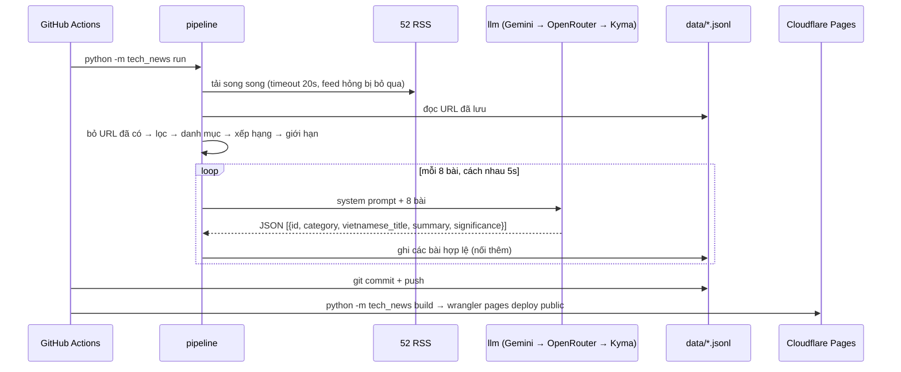

# Kiến trúc và logic

## Luồng một lượt chạy (`pipeline.run`)

## Bộ lọc (`filters.select`)

Thứ tự áp dụng cho mỗi bài:

1. Bỏ nếu thiếu tiêu đề/URL hợp lệ, URL đã lưu trước đó, hoặc trùng URL trong cùng lượt.
2. Bỏ nhiễu hẹp (mã giảm giá, "best deals", Black Friday, sửa chữa xe/thiết bị…) trừ khi có cụm bảo vệ ("bug fixes", "security patches", "cloud services").
3. **Danh mục cố định theo nguồn** (`FORCED`): Product Hunt/Show HN/dev.to #buildinpublic → build-in-public; GitHub Trending/GitHub Open Source/OpenSSF/dev.to #opensource → opensource; Google News → hackathons (bài phải chứa từ như hackathon/cuộc thi/contest); Claude Code Releases/Anthropic → ai-agents. Nguồn này bỏ qua cổng từ khoá.
4. Còn lại phải trúng ít nhất một từ khoá (tiêu đề tính 2 điểm, nội dung 1 điểm; ranh giới từ nên "ai" không khớp "said").
5. Danh mục: bảo mật nếu tiêu đề có từ khoá bảo mật hoặc nội dung có ≥ 2 → mặc định theo nguồn (cloud, security, AI, fullstack) → luật theo từ khoá → `general`.
6. Bỏ bài quá tuổi: 3 ngày, riêng hackathon 45 ngày.
7. Xếp theo điểm rồi ngày; giới hạn 12 bài/danh mục, 3 bài/nguồn (6 với nguồn cố định), tối đa 80 bài/lượt.

## AI (`llm`)

- Mọi provider dùng chuẩn OpenAI `/chat/completions`, nên thêm provider chỉ là thêm một dòng trong `providers()`.
- Thứ tự: Gemini → OpenRouter → Kyma (chỉ provider có key mới được dùng). Mỗi provider thử 2 lần (cách nhau 10s) rồi mới sang provider kế.
- Phản hồi được kiểm tra: phải là mảng JSON, mỗi bài cần `summary` không rỗng và `significance` nguyên 1–5. Bài nào sai bị bỏ riêng, **không lưu**, hôm sau thử lại.
- Danh mục: nguồn cố định luôn giữ danh mục của code; các nguồn còn lại lấy danh mục AI nếu hợp lệ, không thì dùng danh mục của bộ lọc.
- `significance ≥ 4` → `requires_review = true` (hiện ★ trên website).
- `noise` được lưu (để dedup nhớ URL, không gọi AI lại) nhưng website ẩn đi.

## Dữ liệu

Mỗi dòng trong `data/YYYY-MM.jsonl` (tháng theo `processed_at`):

| Trường | Ý nghĩa |
|---|---|
| `title` | tiêu đề tiếng Việt (AI dịch) |
| `summary` | tối đa 2 câu tiếng Việt |
| `url`, `source` | liên kết gốc và tên nguồn |
| `category` | `ai-agents`, `security`, `cloud-infra`, `fullstack`, `opensource`, `build-in-public`, `hackathons`, `general`, `noise` |
| `significance` | 1–5 |
| `published_at`, `processed_at` | ISO 8601 |
| `requires_review` | `significance ≥ 4` |

## Các quyết định và giới hạn đã biết

- **Không server, không database:** chỉ một người dùng, pipeline chạy ~1–2 phút/ngày; file JSONL trong git là đủ (~30k bài/năm) và lịch sử git là backup. *Nâng cấp khi:* cần truy vấn phức tạp hoặc nhiều người dùng → SQLite/Postgres.
- **Trang tĩnh + Cloudflare Access:** `data.json` chứa toàn bộ dữ liệu, bảo vệ bằng Access, không bằng việc giấu URL.
- **X/Twitter không có:** cần đăng nhập và trình duyệt chạy lâu dài, không hợp môi trường Actions. *Nâng cấp khi:* thật sự cần → chạy cùng pipeline trên một máy luôn bật cùng [Agent-Reach](https://github.com/Panniantong/Agent-Reach).
- **Website chỉ hiện 90 ngày** và tải cả `data.json` một lần (~100 KB cho 155 bài); *nâng cấp khi:* file vượt vài MB thì tách theo tháng.
- Lịch Actions có thể trễ hàng giờ hoặc bị bỏ; vì vậy chạy 2 lần/ngày vào phút lẻ (07:17 và 18:47 giờ VN), dữ liệu chống trùng theo URL nên chạy lại không sinh bài trùng.

## Tóm tắt ngày và bản tin Telegram (`brief`)

- `update_brief`: sau khi lưu bài, lấy tối đa 15 bài quan trọng nhất của ngày hôm nay (giờ VN, tối đa 3 bài mỗi danh mục, bỏ opensource và build-in-public), gọi AI một lần với `config/brief-prompt.md`, ghi đè `data/briefs.json[ngày]`. Lỗi thì giữ bản cũ, không làm hỏng lượt chạy.
- `notify`: gửi một tin HTML (tóm tắt + 8 bài nổi bật + link trang) qua Bot API vào channel; cờ `sent` trong `briefs.json` chặn gửi lặp trong ngày. Tin dài hơn 4096 ký tự thì cắt bớt dòng bài ở cuối.
- Trang: `site.build` đưa `briefs` (không kèm `sent`) và link channel vào `data.json`. Danh mục nhẹ (opensource, build-in-public) chỉ xem ở tab Tuần hoặc bấm riêng tab của nó.
- Giới hạn: Telegram chỉ gửi vào channel nên không có danh sách người đăng ký riêng; muốn cá nhân hoá theo người thì cần bot nhận lệnh `/start` (cần máy chủ hoặc webhook).
